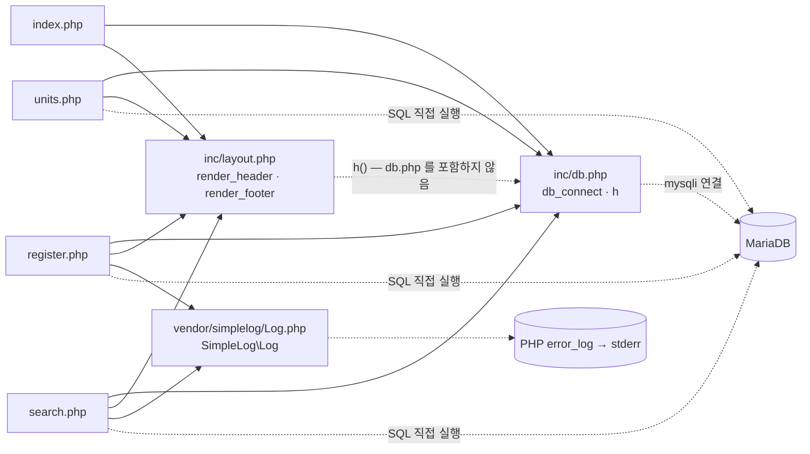

# item-bank-php 아키텍처 (진입점 · 의존 관계)

대상: `legacy/item-bank-php` · 범위: 진입점 · 의존 관계까지. 데이터 흐름 · 비즈니스 규칙은 아직 분석하지 않았다.

## 모듈 개요

- PHP 7.4 + Apache 위에서 도는 문항 은행 화면이다(Dockerfile:1). DB 는 mysqli 로 붙는다(Dockerfile:3, inc/db.php:21).
- 화면은 셋: 문항 검색 · 문항 등록 · 단원 목록(index.php:9-11).
- 프레임워크 · 라우터 없이 `.php` 파일 하나가 URL 하나다. 웹 루트에 모듈 전체를 복사한다(Dockerfile:14).
- 공통 코드는 `inc/db.php`(DB 연결 · `h()`), `inc/layout.php`(머리말 · 꼬리말), 외부 로거 `vendor/simplelog/Log.php` 뿐이다.
- 공통 데이터 접근 계층은 없다. 각 화면 파일이 SQL 을 직접 실행한다.

## 폴더 구조

```
legacy/item-bank-php/
├── Dockerfile                 16줄
├── index.php                  14줄   홈(메뉴)
├── search.php                731줄   문항 검색 — 모듈 코드의 약 69%
├── register.php              177줄   문항 등록
├── units.php                  48줄   단원 목록
├── inc/
│   ├── db.php                 37줄   db_connect(), h()
│   └── layout.php             43줄   render_header(), render_footer()
└── vendor/
    └── simplelog/
        └── Log.php            54줄   외부 라이브러리(더미) — "수정하지 말 것"(Log.php:3)
```

`.htaccess` 는 없다.

## 진입점

| URL / 화면 | 처음 실행되는 파일 | 그 파일이 부르는 주요 함수 |
|---|---|---|
| `/`, `/index.php` · 홈 | `index.php` | `render_header('홈')`(index.php:5), `render_footer()`(index.php:14) |
| `/search.php` · 문항 검색 (GET) | `search.php` | `render_header`(search.php:709) → `db_connect`(search.php:713) → `buildSearchQuery($_GET, $conn)`(search.php:722) → `renderSearchForm`(search.php:723) → `runSearchQuery`(search.php:724) → `renderResultTable`(search.php:725) → `render_footer`(search.php:731) |
| `/register.php` · 문항 등록 (GET 폼 / POST 등록) | `register.php` | `db_connect`(register.php:17). POST 일 때 검증 · INSERT 를 함수 없이 파일 본문에서 처리(register.php:40-125). `render_header`(register.php:127), `render_footer`(register.php:177), `Log::info`(register.php:115) · `Log::error`(register.php:121) |
| `/units.php` · 단원 목록 | `units.php` | `render_header`(units.php:5), `db_connect`(units.php:8), `$conn->query`(units.php:20), `render_footer`(units.php:48) |

- URL = 파일명. `a2enmod rewrite`(Dockerfile:4)는 켜져 있지만 재작성 규칙 파일이 없다.
- 메뉴 링크는 두 곳에 따로 있다: index.php:9-11, inc/layout.php:10-12.
- 웹 루트 전체 복사(Dockerfile:14)라 `/inc/db.php` · `/inc/layout.php` · `/vendor/simplelog/Log.php` 도 URL 로 열린다. 세 파일 모두 정의만 있어 출력은 없다.

## 의존 관계

화살표는 "A → B (A 가 B 를 포함하거나 호출)" 방향이다. 실선은 `require_once`, 점선은 함수 호출이다.



### 포함 (require_once)

| A → B | 근거 |
|---|---|
| index.php → inc/db.php | index.php:2 |
| index.php → inc/layout.php | index.php:3 |
| units.php → inc/db.php | units.php:2 |
| units.php → inc/layout.php | units.php:3 |
| register.php → inc/db.php | register.php:2 |
| register.php → inc/layout.php | register.php:3 |
| register.php → vendor/simplelog/Log.php | register.php:4 |
| search.php → inc/db.php | search.php:20 |
| search.php → inc/layout.php | search.php:21 |
| search.php → vendor/simplelog/Log.php | search.php:22 |

### 호출

| A → B | 호출 | 근거 |
|---|---|---|
| inc/layout.php → inc/db.php | `h()` | layout.php:17, 33 (정의 db.php:34) |
| search.php → inc/db.php | `db_connect()` | search.php:713 |
| register.php → inc/db.php | `db_connect()` | register.php:17 |
| units.php → inc/db.php | `db_connect()` | units.php:8 |
| search.php → vendor/simplelog/Log.php | `setThreshold` · `debug` · `error` | search.php:27 / 103, 528 / 537, 727 |
| register.php → vendor/simplelog/Log.php | `info` · `error` | register.php:115 / 121 |
| vendor/simplelog/Log.php → PHP | `error_log()` → stderr | Log.php:52, Dockerfile:11 |
| search.php 본문 → search.php 함수 | `buildSearchQuery` → `renderSearchForm` → `runSearchQuery` → `renderResultTable` | search.php:722-725 |
| `buildSearchQuery` → DB | unit 단건 조회 · unit 목록 · tag 목록 | search.php:125, 156, 178 |
| `runSearchQuery` → DB | 건수 · 현재 페이지 조회(prepared) | search.php:577, 600 |
| register.php → DB | unit · tag 목록, 다음 id, item · item_tag INSERT | register.php:27, 34, 87, 92-94, 105 |
| units.php → DB | 단원별 공개 문항 수 | units.php:16-20 |

- **숨은 의존:** `inc/layout.php` 는 `h()` 를 쓰지만 `db.php` 를 포함하지 않는다(layout.php:17, 33). `db.php` 를 먼저 require 해야 동작한다.
- `index.php` 는 DB 를 쓰지 않지만 `db.php` 를 포함한다(index.php:2). `db_connect()` 호출은 없다.
- search.php 의 네 함수는 서로 부르지 않고, 반환 배열 `$built` 를 넘겨받는 식으로만 이어진다(search.php:722-725).

## 가장 긴 함수 3개

| # | 파일 | 함수 | 시작–끝 | 길이 | 하는 일 |
|---|---|---|---|---|---|
| 1 | search.php | `buildSearchQuery` | 42–564 | 523줄 | GET 파라미터로 검색 · 건수 SQL, 바인딩 값, 폼 · 요약 · 정렬 링크 HTML, 경고를 한 배열로 만든다(search.php:29-36, 541-563) |
| 2 | search.php | `renderResultTable` | 647–704 | 58줄 | 건수, `<table id="items">`(id · title · unit · level · tags), 0건 메시지, 페이지 링크를 출력한다(search.php:655-703) |
| 3 | search.php | `runSearchQuery` | 571–624 | 54줄 | `count_sql` · `sql` 을 prepared statement 로 실행해 `{total, rows}` 를 돌려준다(search.php:577-623) |

- 길이는 `function` 줄부터 닫는 `}` 까지.
- `register.php` 는 함수가 없다. 177줄 전부가 파일 본문이다(register.php:1-177).

## 미확인

- `buildSearchQuery()` 본문 대부분(search.php:61-524): 파라미터 처리, WHERE · ORDER BY · LIMIT 조립 방식, 정렬 화이트리스트가 있는지, 페이지 크기. 확인한 것은 호출 줄과 `preg_match` 줄(search.php:111, 217, 337)뿐이다.
- search.php:528 `Log::debug` 에 실제로 남는 내용. 임계값이 INFO(search.php:27)라 기본 설정에서는 출력되지 않는다.
- MariaDB 스키마(`db/mariadb/init/`)와 대조하지 않았다.
