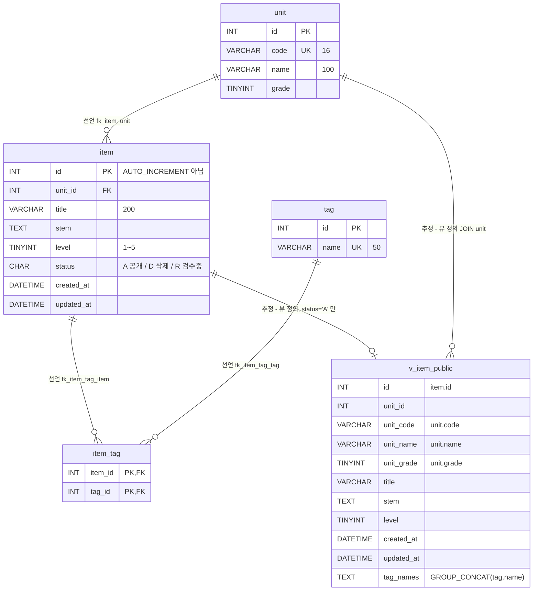

# item-bank-php 데이터 흐름 (테이블 · 관계 · 읽기/쓰기 위치)

대상: `legacy/item-bank-php` · 선행 문서: [ARCHITECTURE.md](ARCHITECTURE.md)(진입점 · 의존 관계).
스키마 근거는 `db/mariadb/init/01-schema.sql`, 코드 근거는 모듈 안의 `.php` 파일이다. 줄번호는 모두 이 두 곳 기준이다.

## 1. 테이블 목록

이 모듈이 실제로 SQL 을 날리는 대상만 적었다. 같은 스키마 파일의 `class` · `assignment` · `distribution` · `submission` 은 이 모듈 코드에서 참조가 없다(assignment-thymeleaf 쪽 테이블, 01-schema.sql:72-115).

| 테이블 | 종류 | 주요 컬럼 | 스키마 근거 | 모듈 안 SQL 근거 |
|---|---|---|---|---|
| `unit` | 테이블 | `id` INT PK, `code` VARCHAR(16) UNIQUE, `name` VARCHAR(100), `grade` TINYINT | 01-schema.sql:11-18 | units.php:16-19, register.php:27, search.php:125, 156 |
| `item` | 테이블 | `id` INT PK, `unit_id` INT FK→unit, `title` VARCHAR(200), `stem` TEXT, `level` TINYINT(1~5), `status` CHAR(1) 기본 `'A'`(A=공개 D=삭제 R=검수중), `created_at` · `updated_at` DATETIME | 01-schema.sql:20-33 | units.php:17, register.php:87, 93-94 |
| `tag` | 테이블 | `id` INT PK, `name` VARCHAR(50) UNIQUE | 01-schema.sql:35-40 | register.php:34, search.php:178, 244 |
| `item_tag` | 테이블(연결) | `item_id` INT FK→item, `tag_id` INT FK→tag, PK(`item_id`, `tag_id`) | 01-schema.sql:42-48 | register.php:105, search.php:244-245 |
| `v_item_public` | **뷰** | `id`, `unit_id`, `unit_code`, `unit_name`, `unit_grade`, `title`, `stem`, `level`, `created_at`, `updated_at`, `tag_names`(태그 이름 `GROUP_CONCAT`, `t.id` 순, 쉼표 구분) — `item.status = 'A'` 인 행만 | 01-schema.sql:52-70 | search.php:521-526 (검색 · 건수 둘 다 이 뷰에서 조회) |

- `item.id` 는 AUTO_INCREMENT 가 아니다(01-schema.sql:21). 등록 화면이 `SELECT COALESCE(MAX(id), 0) + 1 ... FOR UPDATE` 로 다음 id 를 직접 계산한다(register.php:87-90).
- 검색 결과 화면에 실제로 찍히는 컬럼은 `id` · `title` · `unit_code` · `level` · `tag_names` 다(search.php:674-678). `created_at` 은 SELECT 하지만(search.php:521) 정렬(search.php:311, 313)에만 쓰인다.
- `stem` 은 검색 조건 `title LIKE ? OR stem LIKE ?` 에만 쓰이고(search.php:98) 화면에 출력되지 않는다.

## 2. 테이블 관계

- **선언** = `01-schema.sql` 의 `FOREIGN KEY` 제약.
- **추정** = FK 는 없고, 코드의 JOIN · 상관 서브쿼리 · 뷰 정의에서 읽어 낸 관계.



| 관계 | 구분 | 근거 (선언) | 코드에서 같은 관계를 쓰는 곳 |
|---|---|---|---|
| `item.unit_id` → `unit.id` (N:1) | 선언 | 01-schema.sql:32 `fk_item_unit` | 뷰 `JOIN unit u ON u.id = i.unit_id`(01-schema.sql:69), units.php:17 상관 서브쿼리 `i.unit_id = u.id` |
| `item_tag.item_id` → `item.id` (N:1) | 선언 | 01-schema.sql:46 `fk_item_tag_item` | 뷰 `it.item_id = i.id`(01-schema.sql:67), search.php:245 `it.item_id = v_item_public.id` |
| `item_tag.tag_id` → `tag.id` (N:1) | 선언 | 01-schema.sql:47 `fk_item_tag_tag` | 뷰 `JOIN tag t ON t.id = it.tag_id`(01-schema.sql:66), search.php:244 |
| `v_item_public.id` ↔ `item.id` (공개 문항만 1:0..1) | 추정 | FK 없음. 뷰 정의 `FROM item i ... WHERE i.status = 'A'`(01-schema.sql:68-70) | search.php:245 가 `v_item_public.id` 를 `item_tag.item_id` 와 맞대어 태그 필터를 건다 |
| `v_item_public.unit_code` ↔ `unit.code` | 추정 | FK 없음. 뷰 정의 `u.code AS unit_code`(01-schema.sql:56) | search.php:118 이 `unit_code = ?` 로 거르고, 같은 값으로 search.php:125 가 `unit WHERE code = ?` 를 따로 조회한다(JOIN 아님, 같은 파라미터를 두 번 사용) |

- 코드의 JOIN 은 전부 선언된 FK 를 그대로 따른다. **FK 없이 코드에서만 생긴 테이블 간 관계는 찾지 못했다.**
- 모듈 밖 관계: `assignment.unit_id` → `unit.id` 도 선언되어 있다(01-schema.sql:89). 이 모듈 코드는 `assignment` 를 참조하지 않는다.

## 3. 읽기 · 쓰기 위치

`register.php` · `units.php` 는 함수가 없어 "파일 본문"으로 적는다(ARCHITECTURE.md 참고). UPDATE · DELETE 문은 모듈 전체에 없다(`grep -niE "update|delete"` 결과는 register.php:87 의 `FOR UPDATE` 뿐).

### unit

| 구분 | 파일 · 함수 | SQL | 근거 |
|---|---|---|---|
| 읽기 | units.php · 파일 본문 | `SELECT u.id, u.code, u.name, u.grade, (공개 문항 수) FROM unit u ORDER BY u.grade, u.code` | units.php:16-20 |
| 읽기 | register.php · 파일 본문 | `SELECT id, code, name FROM unit ORDER BY grade, code` — 단원 선택 목록 · 입력 검증용 | register.php:27, 61-65 |
| 읽기 | search.php · `buildSearchQuery` | `SELECT name, grade FROM unit WHERE code = ?` — 요약 문구 · "등록되지 않은 단원" 경고용 | search.php:125-146 |
| 읽기 | search.php · `buildSearchQuery` | `SELECT code, name, grade FROM unit ORDER BY grade, code` — 검색 폼 단원 목록 | search.php:156 |
| 읽기(간접) | search.php · `runSearchQuery` | `v_item_public` 를 통해 `unit.code` 를 `unit_code` 로 읽음 | search.php:577, 600 / 01-schema.sql:56-58 |
| 쓰기 | — | 없음 | — |

### item

| 구분 | 파일 · 함수 | SQL | 근거 |
|---|---|---|---|
| 읽기 | units.php · 파일 본문 | `SELECT COUNT(*) FROM item i WHERE i.unit_id = u.id AND i.status = 'A'` (상관 서브쿼리) | units.php:17 |
| 읽기 | register.php · 파일 본문 | `SELECT COALESCE(MAX(id), 0) + 1 AS next_id FROM item FOR UPDATE` — 다음 id 계산, 트랜잭션 안 | register.php:85-90 |
| 읽기(간접) | search.php · `runSearchQuery` | `SELECT COUNT(*) ... FROM v_item_public WHERE ...` / `SELECT id, title, unit_code, level, tag_names, created_at FROM v_item_public WHERE ... ORDER BY ... LIMIT 20 OFFSET <(int)$offset 문자열 연결>` | search.php:521-526(조립, `buildSearchQuery`), 577 · 600(실행) |
| 쓰기 (INSERT) | register.php · 파일 본문 | `INSERT INTO item (id, unit_id, title, stem, level, status, created_at, updated_at) VALUES (?, ?, ?, ?, ?, 'R', NOW(), NOW())` | register.php:92-101 |

- 등록 직후 상태는 `'R'`(검수중)로 고정이다(register.php:84, 94). 뷰가 `status = 'A'` 만 보이므로(01-schema.sql:70) 등록한 문항은 검색 · 단원 목록 건수에 바로 나오지 않는다.

### tag

| 구분 | 파일 · 함수 | SQL | 근거 |
|---|---|---|---|
| 읽기 | register.php · 파일 본문 | `SELECT id, name FROM tag ORDER BY id` — 태그 체크박스 · 입력 검증용 | register.php:34, 74-81 |
| 읽기 | search.php · `buildSearchQuery` | `SELECT name FROM tag ORDER BY id` — 검색 폼 태그 목록 | search.php:178 |
| 읽기 | search.php · `buildSearchQuery`(조립) → `runSearchQuery`(실행) | WHERE 절 `EXISTS (SELECT 1 FROM item_tag it JOIN tag t ON t.id = it.tag_id WHERE it.item_id = v_item_public.id AND t.name = ?)` | search.php:244-247, 577, 600 |
| 읽기(간접) | search.php · `runSearchQuery` | 뷰 컬럼 `tag_names` | search.php:521 / 01-schema.sql:64-67 |
| 쓰기 | — | 없음 | — |

### item_tag

| 구분 | 파일 · 함수 | SQL | 근거 |
|---|---|---|---|
| 읽기 | search.php · `buildSearchQuery`(조립) → `runSearchQuery`(실행) | 위 태그 필터 `EXISTS` 서브쿼리 | search.php:244-245 |
| 읽기(간접) | search.php · `runSearchQuery` | 뷰 컬럼 `tag_names` | 01-schema.sql:64-67 |
| 쓰기 (INSERT) | register.php · 파일 본문 | `INSERT INTO item_tag (item_id, tag_id) VALUES (?, ?)` — 검증된 태그 id 마다 1행, item INSERT 와 같은 트랜잭션 | register.php:104-113, 커밋 114 · 롤백 120 |

### v_item_public (뷰)

| 구분 | 파일 · 함수 | SQL | 근거 |
|---|---|---|---|
| 읽기 | search.php · `runSearchQuery` | 건수 · 현재 페이지 조회(prepared) | search.php:577, 600 |
| 쓰기 | — | 없음(뷰) | — |

## 4. 데이터 흐름 요약

```
[register.php POST]
  unit · tag 목록 읽기 → 입력 검증 → BEGIN
    → item MAX(id)+1 FOR UPDATE → INSERT item(status='R') → INSERT item_tag × n → COMMIT
                                                   (실패 시 ROLLBACK + Log::error)
[search.php GET]
  buildSearchQuery: unit(코드 단건 · 목록) · tag(목록) 읽기, WHERE/ORDER/LIMIT 조립
  runSearchQuery : v_item_public 에서 COUNT → 페이지 행 (item · unit · item_tag · tag 를 뷰가 합침)
[units.php GET]
  unit 전체 + 단원별 item(status='A') 건수
```

## 5. 분석 중 눈에 띈 점 (데이터 흐름 관련)

- **난이도 미지정 시 level 5 가 빠진다.** 주석은 "1~5 모두 포함"이라고 하지만 조건은 `AND level < 5` 다(search.php:213-215). 이관 시 동작 보존 대상인지 버그인지 결정이 필요하다.
- **스키마 주석과 등록 코드 불일치.** 뷰 주석은 "검색 화면과 등록 화면이 모두 이 뷰를 기준으로 삼는다"고 하지만(01-schema.sql:50-51), register.php 는 뷰를 쓰지 않고 `unit` · `tag` · `item` · `item_tag` 를 직접 다룬다.
- **id 채번 방식.** `MAX(id)+1 ... FOR UPDATE`(register.php:87)는 동시 등록 시 잠금 경합이 생긴다. 이관 시 채번 방식을 바꾸면 id 가 달라져 스냅샷 비교에 영향이 있을 수 있다.
- **정렬의 동률 처리.** 모든 정렬에 `id ASC` 가 꼬리로 붙는다(search.php:279-325, `id` 정렬 자체는 제외). 기본 정렬은 `level DESC, id ASC`(search.php:319). `tag_names` 안 순서는 `tag.id` 순이다(01-schema.sql:64).

## 미확인

- **`item.status` 를 `'R'` → `'A'`(검수 완료)나 `'D'`(삭제)로 바꾸는 코드.** 이 모듈에는 UPDATE 문이 없다. 다른 모듈 · 운영 절차 · 수동 SQL 중 어디서 바뀌는지 확인하지 못했다.
- **`item.updated_at` 을 갱신하는 곳.** 이 모듈은 INSERT 때 `NOW()` 로 넣기만 한다(register.php:94). 읽는 곳도 이 모듈에는 없다.
- **`unit` · `tag` 에 쓰는 곳.** 이 모듈에는 없다. 시드(`db/mariadb/init/02-seed.sql`) 외의 쓰기 경로는 확인하지 못했다.
- **`item_tag` 삭제 경로.** 문항 삭제 · 태그 해제 기능이 이 모듈에 없어 확인하지 못했다.
- **search.php 의 `sort` · `dir` · `page` · `q` 외 파라미터 처리 세부**(search.php:61-106, 262-274, 330-445 일부)는 SQL 과 직접 닿는 줄만 읽었다. 페이지 크기 20 · OFFSET 계산은 search.php:523 에서 확인했고, `$offset` 산출식 자체는 읽지 않았다.
- 실제 DB 에 떠 있는 스키마가 `01-schema.sql` 과 같은지(마이그레이션 · 수동 변경 여부)는 컨테이너에 접속해 대조하지 않았다.
